# USER MANUAL

## PSU MENTAL HEALTH PORTAL: AN INTEGRATED DIGITAL WELLNESS AND COUNSELING MANAGEMENT SYSTEM
**Pangasinan State University - Lingayen Campus**

---

### TABLE OF CONTENTS

#### Part 1: How to Register Accounts and Sign In for Students and Counselors
- **Section A: Accessing the Portal and Sign In**
- **Section B: Student Account Registration**
- **Section C: Guidance Counselor and Clinical Staff Registration**
#### Part 2: Student Portal
- **Section A: Navigating the Student Dashboard**
- **Section B: Completing the Mental Health Pre-Assessment Check-in**
- **Section C: Reviewing Assessment Results and Risk Level Breakdown**
- **Section D: Exporting and Printing Official Assessment Score Reports**
- **Section E: Sending Confidential Counselor Messages via Quick Notes**
- **Section F: Conversing with Aria - The AI Mental Health Companion**
- **Section G: Daily Mood Journaling and Emotional Reflection**
- **Section H: Booking and Managing Counseling Appointments**
- **Section I: Engaging in Guided Mindfulness and Breathing Exercises**
- **Section J: Tracking Personal Progress and Session Takeaways**
- **Section K: Accessing Emergency Help and Crisis Hotlines**
- **Section L: Participating in Live Emergency WebRTC Video Calls**
- **Section M: Completing the Post-Consultation Service Quality Evaluation (CSAT Survey)**
- **Section N: Managing Student Profile and Reviewing System Notifications**
#### Part 3: Counselor and Administrator Portal
- **Section A: Clinical Dashboard and Priority Triage Matrix**
- **Section B: Managing Guidance Counselors and Support Staff (Admin Privilege)**
- **Section C: Student Records Directory and AI High-Risk Concentrations**
- **Section D: Individual Student Clinical File, Wellness Trajectory, and Case Notes**
- **Section E: Archived Student Records Management**
- **Section F: Pre-Assessment Question Builder and Custom Scale Configuration**
- **Section G: Managing Counselor Appointments and Session Archive**
- **Section H: Configuring Counselor Availability and Office Hours**
- **Section I: Generating Institutional Mental Health Reports and Analytics**
- **Section J: Emergency Call Center, Video Consultations, and Transcript Logs**
- **Section K: Counselor Professional Profile and System Notification Feed**
#### Part 4: Mobile Application and Progressive Web App (PWA) View
- **Section A: Mobile Responsive Interface and Navigation**
- **Section B: One-Tap Floating Emergency SOS on Mobile**
- **Section C: On-the-Go Wellness Tracking and Mobile AI Chat**

---

# Part 1: How to Register Accounts and Sign In for Students and Counselors

## Section A: Accessing the Portal and Sign In

This section provides a step-by-step guide on how students and guidance counselors can navigate to the portal login interface and sign in using registered credentials or Google Single Sign-On (SSO).

- **Step 1: Open your preferred web browser (e.g., Google Chrome, Mozilla Firefox, Microsoft Edge, or Safari) and navigate to the PSU Mental Health Portal URL.**
- **Step 2: On the Welcome Back sign-in page, enter your registered Email Address and Password into the designated fields.**
- **Step 3: Click the Secure Sign In button to authenticate. The system automatically detects your account role and routes you to your corresponding workspace (Student Dashboard or Counselor Clinical Workspace).**
- **Step 4: Alternatively, users registered with their institutional Google accounts can click Login with Google for single-click authentication.**
- **Step 5: If you do not have an account yet, locate the "Register here" box and click either "I'm a Student" or "I'm a Counselor" to navigate to the appropriate onboarding form.**

> **Note:** Always ensure you keep your login credentials secure. Guidance counselors and students utilize distinct access privileges to safeguard clinical and personal privacy.

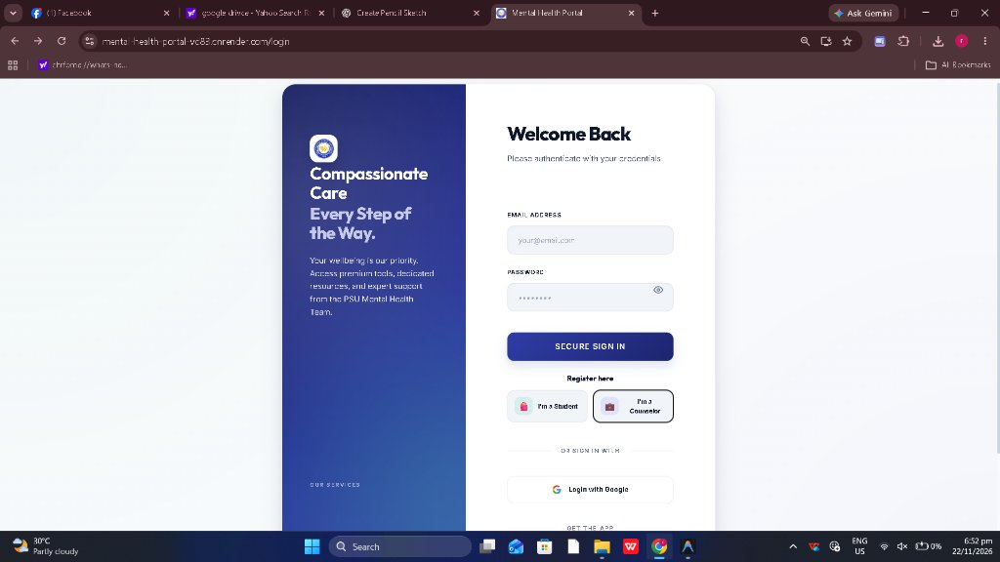
*Figure 1: Dual Sign In Interface for Students and Counselors with Google OAuth*

---

## Section B: Student Account Registration

This section provides step-by-step instructions for university students on registering a new personal account to access mental health services, mood tracking, and counseling.

- **Step 1: On the sign-in page, click the "I'm a Student" button under "Register here" or navigate directly to the registration page (/register).**
- **Step 2: Under the Personal Identity section, enter your Full Name (e.g., Juan Dela Cruz), official Student ID / Faculty ID (e.g., 2024-XXXXX), active Email Address, and personal Mobile Number.**
- **Step 3: Under the Demographics section, input your Date of Birth using the calendar picker and choose your Gender Identity from the dropdown options.**
- **Step 4: Under Academic Context, specify your Academic Course (e.g., BS Information Technology), select your Current Semester, and choose your Department / College from the dropdown menu.**
- **Step 5: Enter a secure password, re-enter it to confirm, and click Create Account to complete registration.**

> **Note:** Account verification is required. All personal demographic and clinical information entered is 100% confidential under university data privacy guidelines.

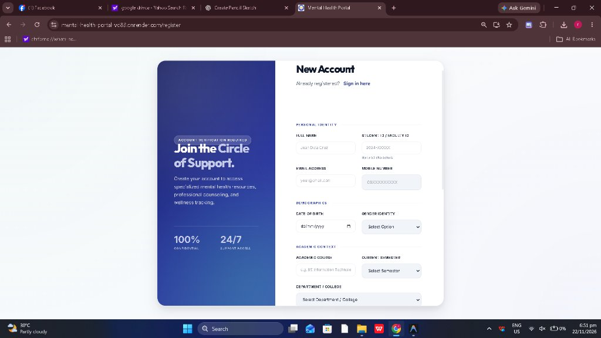
*Figure 2: Student Account Registration and Academic Onboarding Form*

---

## Section C: Guidance Counselor and Clinical Staff Registration

This section outlines how authorized university guidance counselors and clinical responders register their credentials to manage student triage, appointments, and therapy sessions.

- **Step 1: On the sign-in page, click the "I'm a Counselor" button or navigate to the counselor registration form (/register/counselor).**
- **Step 2: Enter your Full Name and assigned Staff / Faculty ID (e.g., EMP-2024-001).**
- **Step 3: Select your assigned Department / College from the administrative dropdown menu.**
- **Step 4: Provide your institutional Email Address and active Contact Number.**
- **Step 5: Create a strong password, confirm the password in the next field, and click Register as Counselor to submit your registration.**

> **Note:** Counselor accounts gain direct access to clinical triage tools, emergency call monitors, and student records upon successful registration.

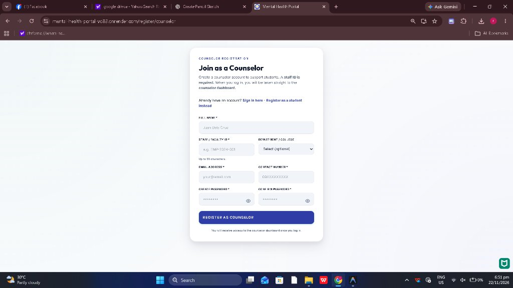
*Figure 3: Guidance Counselor and Clinical Staff Registration Form*

---

# Part 2: Student Portal

## Section A: Navigating the Student Dashboard

This section guides students through the primary features, wellness reminders, and quick action cards available upon signing into the Student Dashboard.

- **Step 1: Upon signing in, review the Student Dashboard homepage to view your account greeting, wellness reminders, and current wellbeing statistics.**
- **Step 2: Read the Gentle Reminders card at the top of the screen for daily self-care suggestions such as taking deep breaths, staying hydrated, or stepping outdoors.**
- **Step 3: Use the Quick Actions cards to immediately take a wellness check-in, begin an AI chat session with Aria, or book a counseling appointment.**
- **Step 4: Review your Check-in Streak counter and weekly wellness overview to observe your consistency.**
- **Step 5: Navigate between different modules using the left navigation sidebar: Dashboard, Pre-Assessment, Quick Note, Talk to Assistant, Mood Journal, Appointments, Mindfulness, My Progress, and My Profile.**

> **Note:** You can access the high-visibility red Emergency Help button from any screen in the student portal.

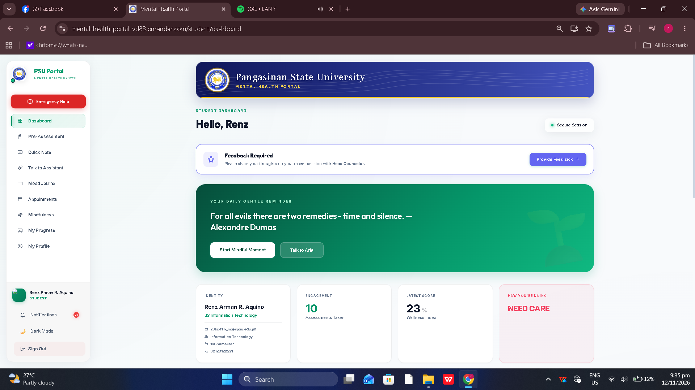
*Figure 4: Student Wellness Dashboard Overview with Reminders and Quick Actions*

---

## Section B: Completing the Mental Health Pre-Assessment Check-in

This section explains how students complete the standardized psychometric wellness check-in questionnaire based on the DASS-21 scale.

- **Step 1: From the left navigation menu, click Pre-Assessment or click the "Take Check-in" card from the dashboard.**
- **Step 2: Read the questionnaire instructions. The pre-assessment consists of standardized items measuring how frequently you experienced specific emotional and physical states over the past week.**
- **Step 3: For each statement, choose the response option that best describes your experience: (0) Did not apply to me at all, (1) Applied to me to some degree, (2) Applied to me to a considerable degree, or (3) Applied to me very much.**
- **Step 4: (Optional) If you prefer reading questions in Filipino/Tagalog, use the multilingual translation toggle at the top of the questionnaire.**
- **Step 5: After answering all questions, click the Submit Assessment button to process your responses and generate your clinical evaluation.**

> **Note:** Please answer honestly. Your responses are strictly confidential and enable counselors to provide prompt, tailored support.

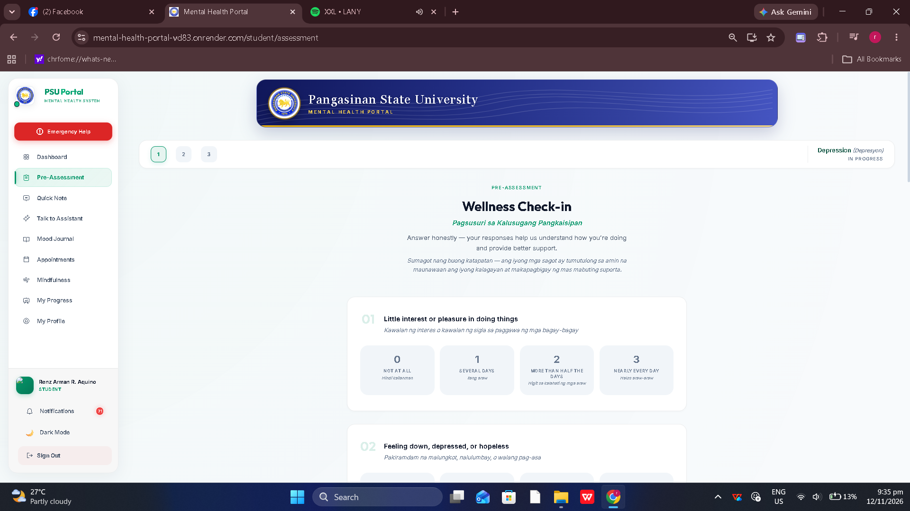
*Figure 5: Standardized Mental Health Pre-Assessment Check-in Questionnaire*

---

## Section C: Reviewing Assessment Results and Risk Level Breakdown

This section guides students on understanding their pre-assessment results, sub-domain severity levels, and AI clinical insights.

- **Step 1: Following questionnaire submission, review your personalized Assessment Results screen.**
- **Step 2: Examine the three psychometric subscales: Low Mood (Depression), Worries (Anxiety), and Pressure (Stress).**
- **Step 3: Check your assigned severity badges: Normal, Mild, Moderate, Severe, or Extremely Severe for each domain.**
- **Step 4: Read the AI Clinical Insight breakdown explaining your scores, recognizing emotional patterns, and recommending coping techniques.**
- **Step 5: Review recommended next steps, such as booking an appointment with a counselor or practicing guided mindfulness.**

> **Note:** High or severe risk level scores trigger an automated alert on the counselor triage matrix so on-duty guidance staff can reach out.

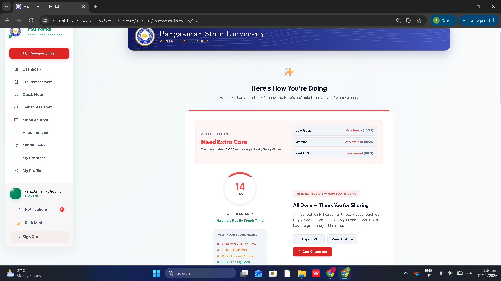
*Figure 6: Assessment Results Display with Domain Sub-scores and Severity Badges*

---

## Section D: Exporting and Printing Official Assessment Score Reports

This section details how students can download and print an official PDF report of their pre-assessment results for personal records or external consultation.

- **Step 1: From the Assessment Results page or the My Progress archive, click the "Download PDF Summary" button.**
- **Step 2: The system compiles an official university document entitled "Pangasinan State University Mental Health Portal - Pre-Assessment Summary Score Report".**
- **Step 3: Review the generated PDF document, verifying student identification, evaluation date, subscale scores, and official institutional watermark.**
- **Step 4: Save the PDF file to your local computer or mobile device, or click Print to generate a physical paper copy.**

> **Note:** Exported PDF reports serve as official records of psychometric evaluation within the Pangasinan State University counseling system.

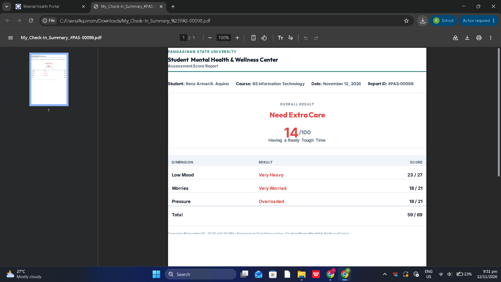
*Figure 7: Official Exported Pre-Assessment Summary PDF Score Report*

---

## Section E: Sending Confidential Counselor Messages via Quick Notes

This section explains how students can reach guidance counselors asynchronously for private questions, advice, or concerns without scheduling an in-person session.

- **Step 1: From the left sidebar, click Quick Note.**
- **Step 2: Type your concern, question, or emotional burden into the secure message composer.**
- **Step 3: (Optional) Toggle the "Anonymous Mode" switch if you prefer to submit your query anonymously while still receiving counselor responses.**
- **Step 4: Click the Send Note button to dispatch your message directly to the counselor triage queue.**
- **Step 5: Review past notes and counselor responses in the threaded conversation history displayed below the composer.**

> **Note:** Quick Notes are monitored during campus office hours. For immediate emergencies, use the red Emergency Help button.

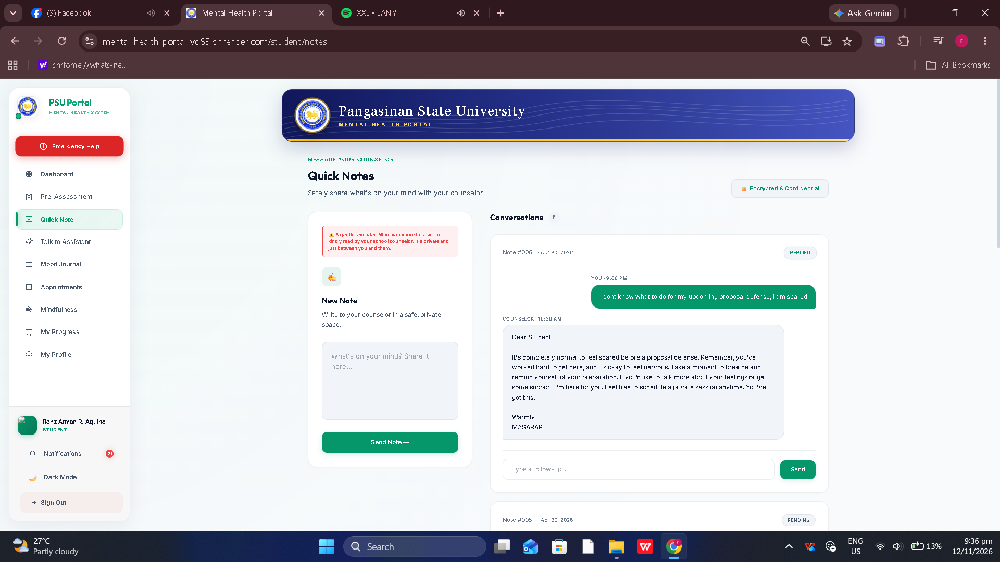
*Figure 8: Confidential Counselor Messaging Thread via Quick Notes*

---

## Section F: Conversing with Aria - The AI Mental Health Companion

This section instructs students on how to engage with Aria, the 24/7 AI-driven conversational assistant designed for compassionate emotional support and grounding.

- **Step 1: Click "Talk to Assistant" on the navigation menu to open the Aria interactive chat interface.**
- **Step 2: Type a message into the input field or click one of the suggested conversation starter prompts.**
- **Step 3: Click the Send icon to receive instant empathetic feedback, cognitive reframing suggestions, and coping exercises.**
- **Step 4: Click the "Start New Chat" button whenever you wish to clear context and begin an entirely new topic.**
- **Step 5: Review AI-generated session takeaways, insights, and key reminders displayed in the right conversation panel.**

> **Note:** Aria is an artificial intelligence support tool and does not replace human clinical diagnosis. In crisis situations, Aria immediately displays emergency hotline contacts.

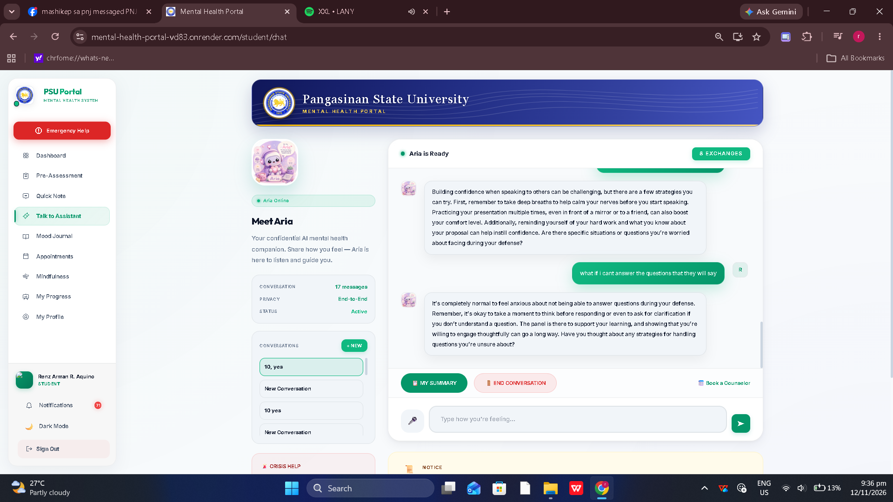
*Figure 9: Aria - 24/7 AI Mental Health Conversational Companion*

---

## Section G: Daily Mood Journaling and Emotional Reflection

This section details how students record daily moods, reflect on daily events, and track emotional patterns over time.

- **Step 1: Select "Mood Journal" from the left navigation menu.**
- **Step 2: Select the emoji that best represents how you feel today (Great, Good, Okay, Down, or Rough).**
- **Step 3: Enter your daily reflection in the text area, noting what factors (e.g., classes, family, sleep, exams) influenced your feelings.**
- **Step 4: Click the Save Journal Entry button to record your mood into your personal wellness calendar.**
- **Step 5: Review your previous journal reflections in the timeline history below to observe changes in emotional patterns.**

> **Note:** Regular journaling builds emotional self-awareness and helps you identify specific triggers impacting your mental health.

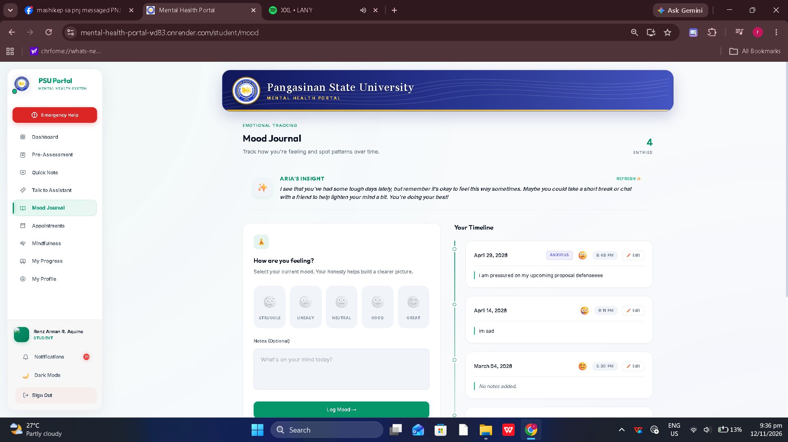
*Figure 10: Daily Mood Journaling Interface with Emotional Reflection Timeline*

---

## Section H: Booking and Managing Counseling Appointments

This section guides students through scheduling one-on-one counseling consultations with guidance counselors and tracking appointment statuses.

- **Step 1: From the left sidebar, click Appointments.**
- **Step 2: Click the "Book an Appointment" button to open the appointment booking modal.**
- **Step 3: Select your preferred counselor or choose "Any Available Counselor".**
- **Step 4: Select an available date and preferred time slot from the counselor's published schedule.**
- **Step 5: Choose your consultation format: "In-Person" (guidance office) or "Online Video Consultation".**
- **Step 6: Briefly specify the reason for your visit or concerns you would like to discuss, then click Submit Request.**
- **Step 7: Monitor your appointment list to view the current status: Pending, Confirmed, Completed, or Cancelled.**

> **Note:** Once an appointment is completed by your counselor, a "Leave Feedback" button becomes available to rate your consultation experience.

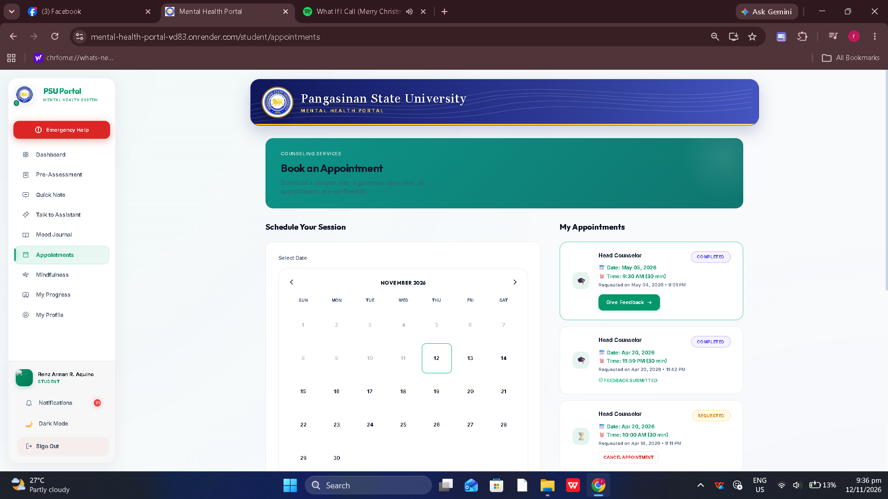
*Figure 11: Counseling Appointment Booking, Schedule Calendar, and Status Tracking*

---

## Section I: Engaging in Guided Mindfulness and Breathing Exercises

This section explains how to use the interactive mindfulness suite and diaphragmatic breathing tools to ease acute stress and calm the nervous system.

- **Step 1: Click "Mindfulness" on the navigation menu.**
- **Step 2: Locate the 4-7-8 Breathing Exercise module.**
- **Step 3: Click Start Exercise to initiate the paced visual sphere timer: Inhale quietly through the nose for 4 seconds as the sphere expands; Hold your breath for 7 seconds; Exhale slowly through the mouth for 8 seconds as the sphere contracts.**
- **Step 4: Complete the recommended four breathing cycles to restore calm and steady your heart rate.**
- **Step 5: Explore complementary grounding resources, such as the 5-4-3-2-1 Sensory Grounding exercise provided on the page.**

> **Note:** The 4-7-8 breathing method acts as a natural tranquilizer for the nervous system and can be practiced anytime you feel overwhelmed.

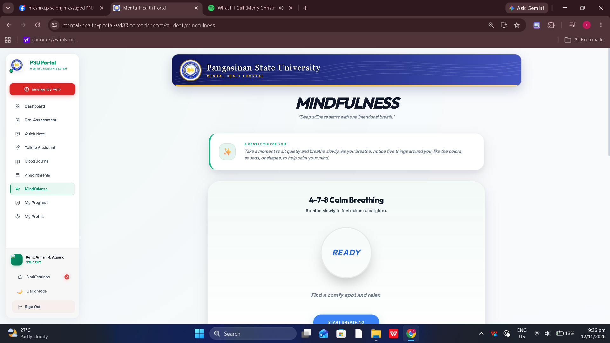
*Figure 12: Interactive 4-7-8 Guided Diaphragmatic Breathing and Mindfulness Tools*

---

## Section J: Tracking Personal Progress and Session Takeaways

This section guides students on reviewing their longitudinal wellness trajectory, AI chat takeaways, and therapeutic progress.

- **Step 1: Select "My Progress" from the left navigation menu.**
- **Step 2: Inspect the Key Takeaways section summarizing important insights, coping strategies, and action steps generated from your counseling sessions and Aria chats.**
- **Step 3: Review your cumulative check-in score trajectory graph to observe progress over weeks and months.**
- **Step 4: Read your personalized motivational affirmations and view your completed check-in milestones.**

> **Note:** Tracking your progress over time reinforces resilience and provides objective feedback on your mental wellness journey.

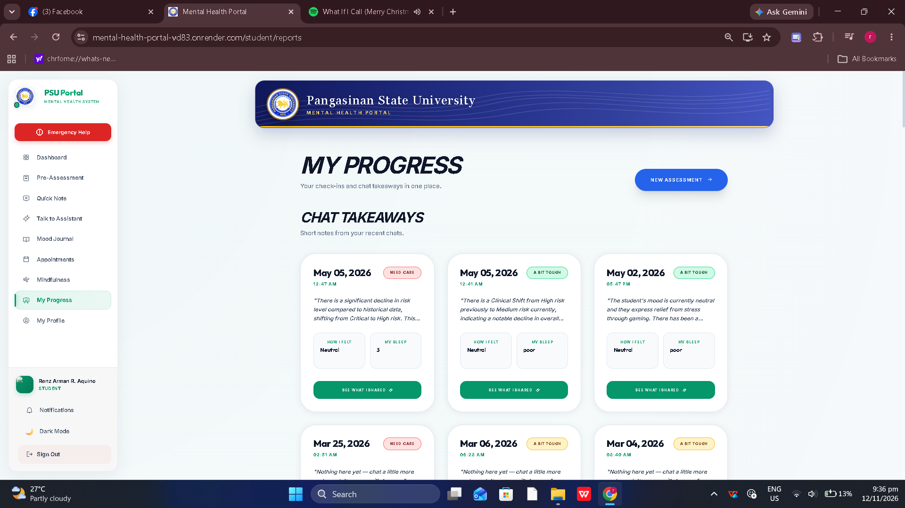
*Figure 13: My Progress Analytics with AI-Synthesized Session Takeaways*

---

## Section K: Accessing Emergency Help and Crisis Hotlines

This section provides instructions for students in acute crisis on how to access immediate emergency campus assistance and national 24/7 hotlines.

- **Step 1: Click the red Emergency Help button positioned at the top of the left sidebar from any page.**
- **Step 2: Review verified crisis contacts: PSU Lingayen Campus Security & Medical Clinic, National Center for Mental Health (NCMH) Hotline (1553 / 0917-899-USAP), Hopeline Philippines (0917-558-4673), and In-Touch Community Services ((02) 8893-7603).**
- **Step 3: Click the prominent "Call Counselor Now" button to initiate an instant encrypted video or audio crisis call with the on-duty guidance counselor.**
- **Step 4: If you or someone you know is in immediate life-threatening danger, dial 911 or proceed to the nearest hospital emergency room immediately.**

> **Note:** Emergency services are available 24/7. Never hesitate to reach out for immediate professional intervention during a crisis.

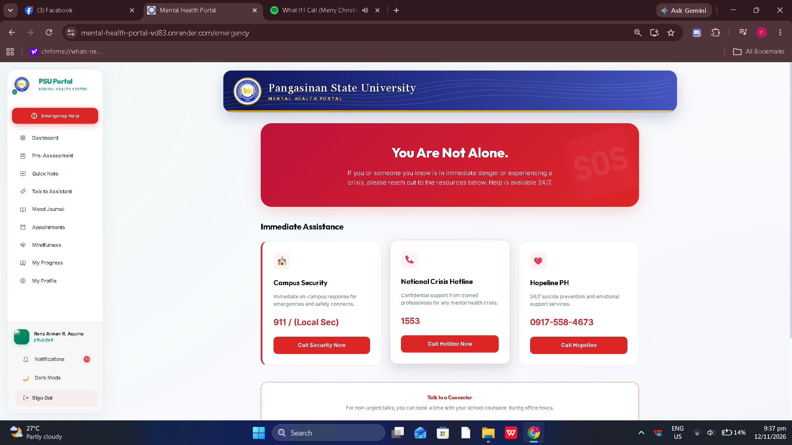
*Figure 14: Emergency Crisis Response Center, Campus Contacts, and National Hotlines*

---

## Section L: Participating in Live Emergency WebRTC Video Calls

This section explains how students interact with counselors during a live encrypted video consultation session.

- **Step 1: Upon clicking "Call Counselor Now" or joining an online appointment, grant browser permissions for Camera and Microphone.**
- **Step 2: Wait briefly as the peer-to-peer WebRTC connection establishes securely with the guidance counselor.**
- **Step 3: View the counselor in the main video stream while monitoring your local preview in the corner overlay.**
- **Step 4: Use the bottom toolbar to toggle video feed on/off, mute/unmute audio, or exchange text messages in the side chat panel.**
- **Step 5: When the session concludes, click End Call to safely terminate the video transmission.**

> **Note:** Video calls are end-to-end encrypted to guarantee strict medical confidentiality during remote consultations.

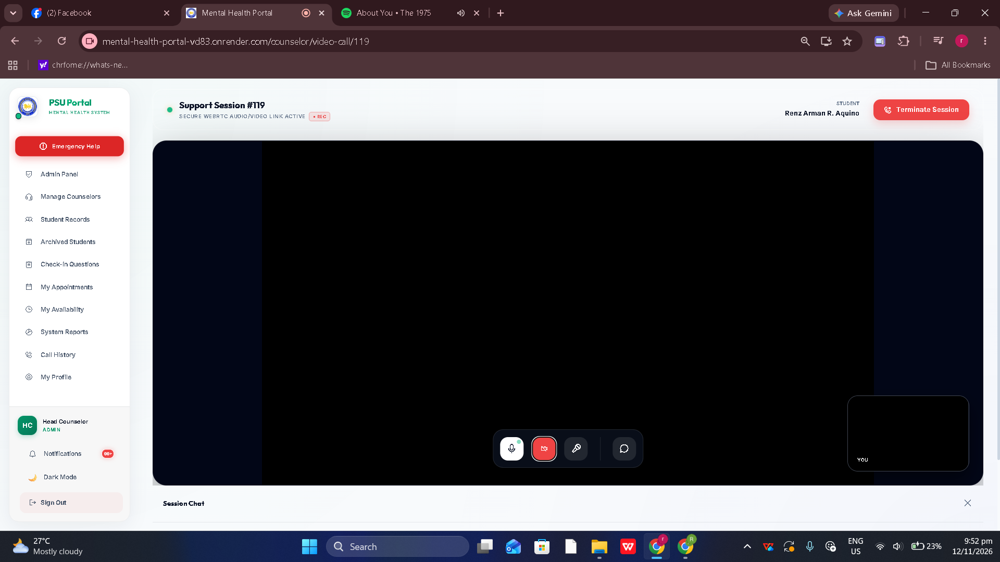
*Figure 15: Secure WebRTC Live Emergency Video Consultation Interface*

---

## Section M: Completing the Post-Consultation Service Quality Evaluation (CSAT Survey)

This section details how students evaluate counseling services after completed consultations to support institutional quality assurance.

- **Step 1: Following the conclusion of a counseling appointment, open the survey notification or navigate to the survey link (/student/survey/{id}).**
- **Step 2: On the "How Was Your Talk?" evaluation form, read each evaluation statement.**
- **Step 3: Rate each criterion on a 1-to-5 Likert scale (1 = Strongly Disagree to 5 = Strongly Agree, or N/A): (a) Overall, I felt cared for and supported in my session; (b) My session lasted a good amount of time for me; (c) My counselor guided our talk well step by step; (d) It was easy to know what to do for my session.**
- **Step 4: (Optional) Enter qualitative feedback or comments in the provided text area.**
- **Step 5: Click Submit Evaluation to send your responses anonymously to university administration.**

> **Note:** Student satisfaction surveys are entirely anonymous and used exclusively to maintain high institutional counseling standards.

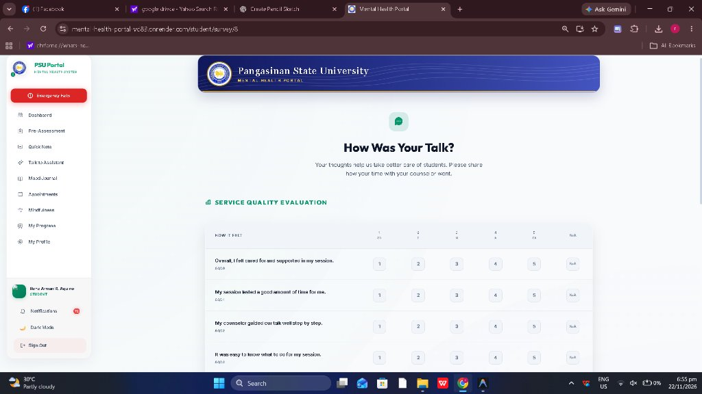
*Figure 16: Post-Consultation Service Quality Evaluation (CSAT Likert Survey)*

---

## Section N: Managing Student Profile and Reviewing System Notifications

This section instructs students on how to maintain accurate profile records and check real-time system alerts.

- **Step 1: Click "My Profile" at the bottom of the navigation sidebar.**
- **Step 2: Review and update your demographic details, contact number, emergency parent contacts, and academic degree information, then click Save Profile.**
- **Step 3: Click "Notifications" on the sidebar or click the notification bell icon to view updates on appointment approvals, counselor replies, and reminders.**
- **Step 4: Click on any notification to jump directly to the relevant activity or click "Mark All as Read" to clear the notification badge.**

> **Note:** Keep your contact and emergency details up to date so university guidance staff can reach your family if urgent need arises.

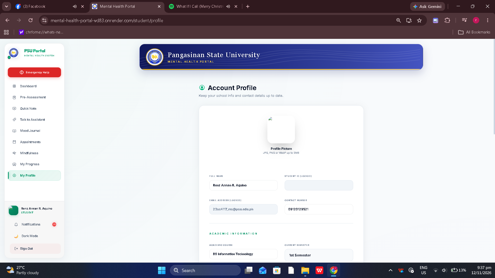
*Figure 17: Student Profile Management and Academic Information Form*

---

# Part 3: Counselor and Administrator Portal

## Section A: Clinical Dashboard and Priority Triage Matrix

This section provides guidance counselors and clinical supervisors with a walkthrough of the Counselor Dashboard, triage queue, and active caseload indicators.

- **Step 1: Log in with counselor credentials to open the primary Counselor Clinical Dashboard.**
- **Step 2: Review the statistical overview cards: Total Registered Students, Pending Assessments, High-Risk Triage Cases, and Today's Appointments.**
- **Step 3: Inspect the Priority Triage Matrix displaying students whose recent DASS-21 pre-assessments indicate severe depression, anxiety, or stress.**
- **Step 4: Toggle your Emergency Status switch at the top of the screen to signal whether you are currently available to receive incoming emergency crisis calls.**
- **Step 5: Use the left navigation sidebar to access: Admin Panel, Manage Counselors, Student Records, Archived Students, Check-In Questions, My Appointments, My Availability, System Reports, Call History, and My Profile.**

> **Note:** The Priority Triage Matrix automatically ranks cases by clinical risk level, ensuring students experiencing acute distress receive immediate follow-up.

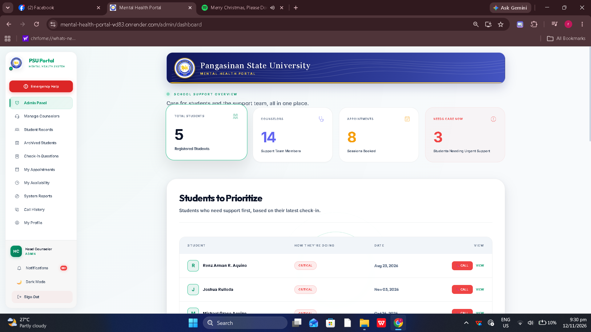
*Figure 18: Counselor Clinical Dashboard and Priority Distress Triage Matrix*

---

## Section B: Managing Guidance Counselors and Support Staff (Admin Privilege)

This section explains how administrators register new counseling staff, update departmental assignments, and maintain staff rosters.

- **Step 1: From the left administrative sidebar, click Manage Counselors.**
- **Step 2: Review the staff roster displaying Counselor Names, Institutional Emails, Staff IDs, Assigned Departments, and Active Statuses.**
- **Step 3: Click the "Add Counselor" button to register a new guidance staff member, entering their full name, staff ID, department, and contact information.**
- **Step 4: Edit permissions, update office room assignments, or deactivate accounts when staff are on leave.**
- **Step 5: Save changes to commit updates to the institutional user directory.**

> **Note:** Staff management privileges are restricted to designated Head Counselors and System Administrators.

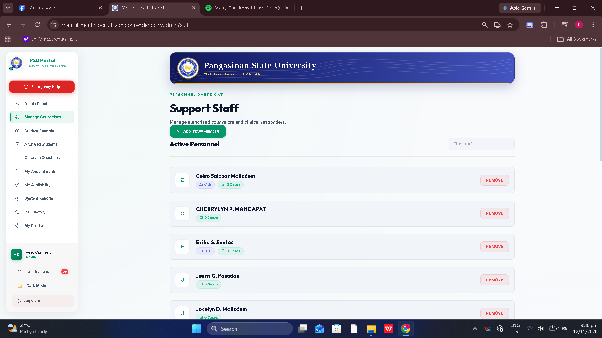
*Figure 19: Guidance Counselor Staff Management and Department Assignment (Admin)*

---

## Section C: Student Records Directory and AI High-Risk Concentrations

This section covers searching student records, filtering by college department, and reviewing AI-identified psychological risk distributions.

- **Step 1: Click "Student Records" from the left navigation menu.**
- **Step 2: Use the search field to quickly locate students by full name, student ID number, or academic course.**
- **Step 3: Apply filter tabs to view students by College Department or Risk Category (High Risk, Moderate, Mild, or Normal).**
- **Step 4: Identify students flagged with AI High-Risk badges indicating recent self-harm markers or critical assessment subscale spikes.**
- **Step 5: Click on any student row to open their comprehensive clinical profile and case history.**

> **Note:** All student clinical records are protected under FERPA and Philippine Data Privacy Act standards.

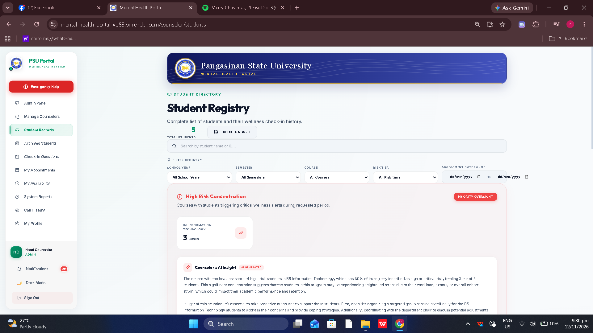
*Figure 20: Student Records Registry with Departmental Filters and AI Risk Tags*

---

## Section D: Individual Student Clinical File, Wellness Trajectory, and Case Notes

This section instructs counselors on inspecting complete student clinical files (case study: Joshua Rulloda), evaluating wellness trajectories, and logging formal session notes.

- **Step 1: Open a student's clinical file from the Student Records registry to view their comprehensive clinical profile.**
- **Step 2: Review the Student Contact card (name, student ID, department, semester, email, phone) and Parent / Guardian card (emergency contact person, guardian phone, and email).**
- **Step 3: Analyze the Wellness Trajectory Graph displaying the student's longitudinal wellness score history across multiple check-ins to evaluate recovery progress or regression.**
- **Step 4: Under Archive Session, enter clinical observations, therapeutic modalities used, and action plans into the Session Notes box.**
- **Step 5: Click "Save Session Notes" to record the entry into the student's permanent clinical history.**
- **Step 6: Click "Export File" to generate an official confidential clinical dossier PDF for university case archiving.**

> **Note:** Case notes are time-stamped and encrypted. Parent contacts should only be utilized in verified emergency circumstances.

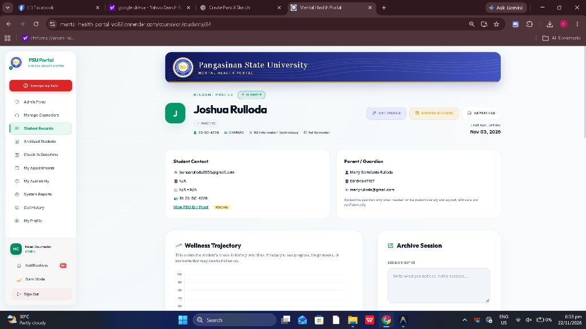
*Figure 21: Individual Student Clinical File, Longitudinal Wellness Trajectory, and Notes*

---

## Section E: Archived Student Records Management

This section details how counselors search historical files, review inactive student cases, and restore profiles when students return.

- **Step 1: From the left sidebar, click "Archived Students".**
- **Step 2: Search for past student cases by name, student ID, or semester of archive.**
- **Step 3: Click "View Case File" to review past counseling interventions, assessment histories, and clinical dispositions.**
- **Step 4: If a student resumes active counseling or re-enrolls, click "Restore Student" to return the profile to the active registry.**

> **Note:** Archiving preserves complete historical data without cluttering active daily triage queues.

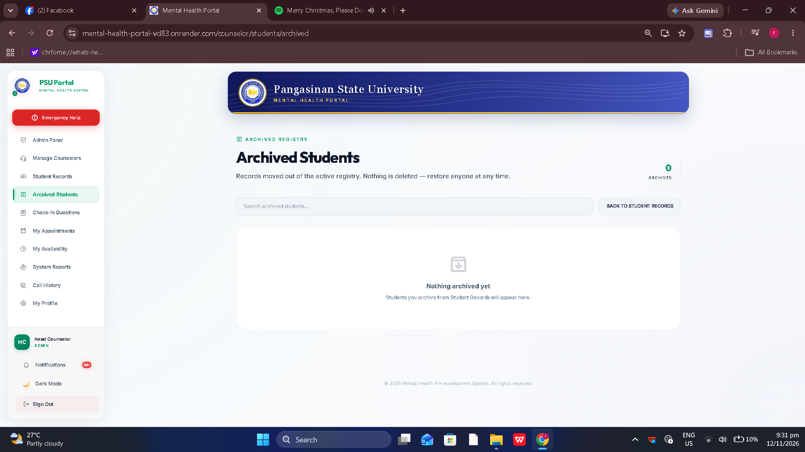
*Figure 22: Archived Student Case Records and Historical Search Directory*

---

## Section F: Pre-Assessment Question Builder and Custom Scale Configuration

This section guides counselors on configuring psychological check-in questions, modifying scoring weights, and maintaining psychometric scale standards.

- **Step 1: Click "Check-In Questions" from the left navigation menu.**
- **Step 2: Review the table of active assessment items with their assigned domains (Depression, Anxiety, Stress), scoring weights, and status.**
- **Step 3: Click "Add Question" to introduce a new psychometric question prompt, select the corresponding domain category, and assign score weights.**
- **Step 4: Edit or re-order existing questions, or update Filipino/Tagalog translations to enhance clarity for students.**
- **Step 5: Click Save Changes to immediately deploy the updated assessment questionnaire to the student portal.**

> **Note:** Modifications to questionnaire scales should align with standard institutional psychometric guidelines (e.g., DASS-21).

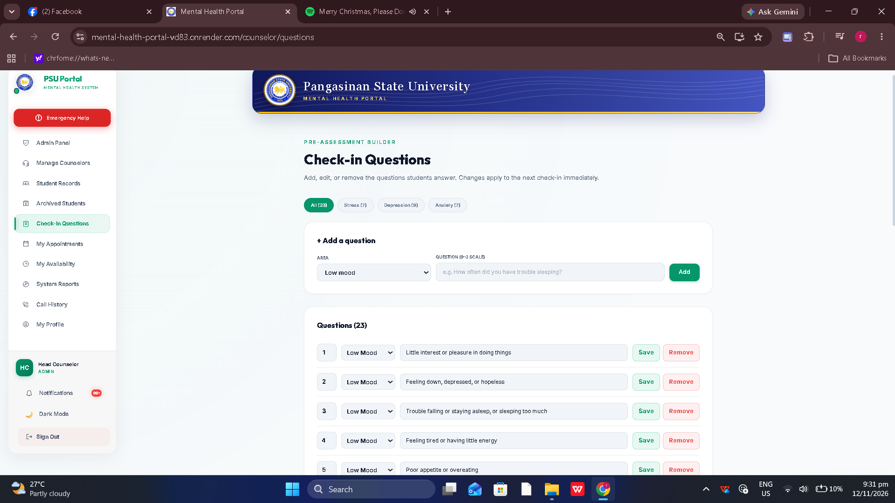
*Figure 23: Pre-Assessment Question Builder and Psychometric Scale Configuration*

---

## Section G: Managing Counselor Appointments and Session Archive

This section explains how counselors review consultation requests, manage booking queues, confirm or reschedule sessions, and record outcomes.

- **Step 1: From the left navigation menu, click "My Appointments".**
- **Step 2: Review appointments filtered by tabs: Upcoming, Pending Approval, Completed, and Cancelled.**
- **Step 3: For pending bookings, check the student name, date/time, selected mode (In-Person or Video Call), and stated consultation reason.**
- **Step 4: Click "Approve" to confirm the consultation or "Reschedule" to offer alternative time slots.**
- **Step 5: Once a consultation concludes, click "Mark Completed" to record post-session notes and trigger the automated student CSAT feedback survey.**

> **Note:** Timely confirmation of student appointment requests reduces anxiety and fosters an encouraging support environment.

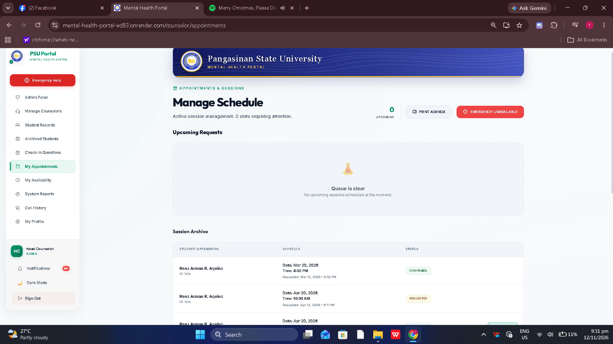
*Figure 24: Counselor Appointment Queue, Booking Approvals, and Session Archive*

---

## Section H: Configuring Counselor Availability and Office Hours

This section guides counselors on setting their recurring consultation schedule, active days, session durations, and break buffers.

- **Step 1: Select "My Availability" from the left navigation menu.**
- **Step 2: Toggle the days of the week you are available for student consultations (e.g., Monday through Friday).**
- **Step 3: For each active day, configure your consultation start time, end time, and break/lunch buffer periods.**
- **Step 4: Specify appointment slot duration (e.g., 30, 45, or 60 minutes) and maximum daily consultation limits.**
- **Step 5: Click Save Availability to publish your updated schedule slots on the student booking calendar.**

> **Note:** Configuring buffer periods between sessions prevents consultation overruns and provides adequate time for clinical note entry.

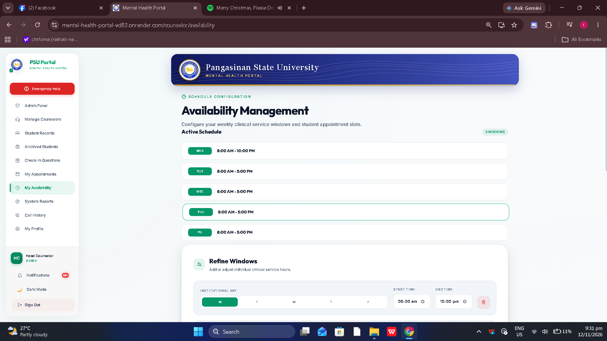
*Figure 25: Counselor Clinical Availability and Weekly Consultation Windows*

---

## Section I: Generating Institutional Mental Health Reports and Analytics

This section instructs administrators and counselors on generating institutional mental health metrics, DASS distributions, and compliance reports.

- **Step 1: Click "System Reports" from the left administrative menu.**
- **Step 2: Select the reporting timeframe (e.g., Monthly, Semester Midterms, Final Term, or Custom Date Range).**
- **Step 3: Review the statistical charts: Campus-Wide DASS-21 Severity Distribution, Departmental Stress Indices, Consultation Volume, and Average CSAT Ratings.**
- **Step 4: Click "Export to PDF" or "Export to Excel" to download formalized statistical reports for university executives and academic boards.**

> **Note:** Institutional reports aggregate data anonymously, providing high-level trends without exposing individual student identities.

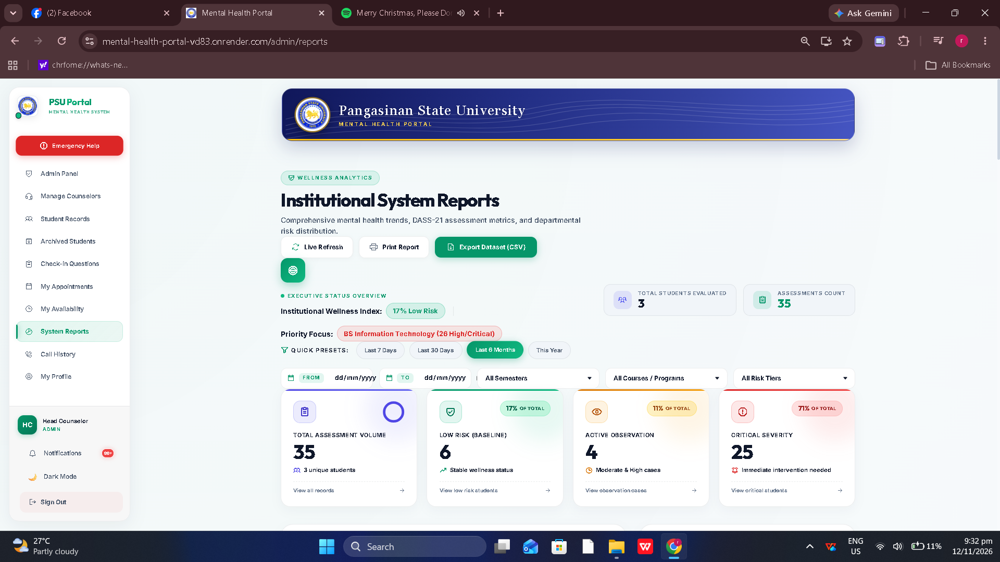
*Figure 26: Institutional System Reports, Psychological Analytics, and Data Export*

---

## Section J: Emergency Call Center, Video Consultations, and Transcript Logs

This section details managing emergency crisis calls, connecting through encrypted WebRTC video, and auditing historical call logs and transcripts.

- **Step 1: Click "Call History" from the navigation sidebar to open the Emergency Communication Center.**
- **Step 2: Review the Past Call Sessions table showing Call ID, Student Name, Assigned Officer, Time & Duration, and Call Status (Ended, Missed, In-Progress).**
- **Step 3: Click the "Transcript" button beside any completed call to view the comprehensive audio transcript and text chat logs.**
- **Step 4: When an incoming emergency call alert triggers on screen, click "Accept Call" to open the live encrypted video consultation terminal.**
- **Step 5: Communicate with the student using live video/audio, apply de-escalation protocols, review their file in real-time, and click End Call to finalize the session.**

> **Note:** Call transcripts are stored in encrypted form and provide critical audit trails for institutional accountability and clinical supervision.

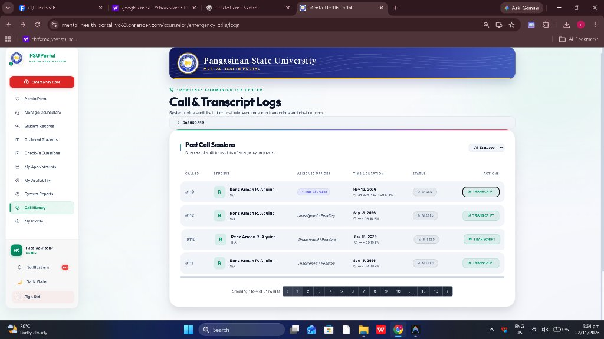
*Figure 27: Emergency Call Transcripts and Detailed Communication Audit Logs*

---

## Section K: Counselor Professional Profile and System Notification Feed

This section explains how counselors maintain their professional bio, office location, and monitor real-time clinical alerts.

- **Step 1: Click "My Profile" at the bottom of the navigation sidebar.**
- **Step 2: Update your professional title, clinical credentials, office room location, email address, and account password, then save updates.**
- **Step 3: Click "Notifications" from the sidebar to review system alerts: emergency call notifications, high DASS-21 assessment submissions, and new student appointments.**
- **Step 4: Click any alert to navigate directly to the relevant student file or appointment details.**

> **Note:** Maintaining accurate office hours and room information ensures students can easily locate in-person consultations.

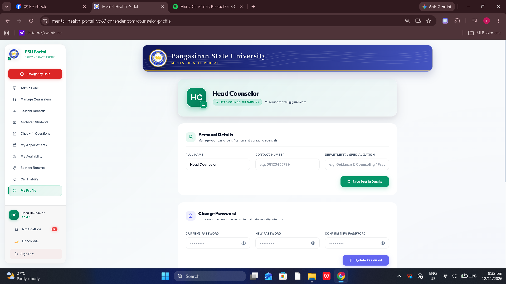
*Figure 28: Counselor Professional Profile and Credentials Management*

---

# Part 4: Mobile Application and Progressive Web App (PWA) View

## Section A: Mobile Responsive Interface and Navigation

This section guides users on accessing the PSU Mental Health Portal via mobile web browsers or installing it as a Progressive Web App (PWA).

- **Step 1: Open your smartphone browser (Chrome on Android, Safari on iOS) and navigate to the portal URL.**
- **Step 2: Sign in with your student or counselor credentials. The interface automatically adapts into a mobile-first responsive layout.**
- **Step 3: Tap the hamburger navigation menu at the top left to expand the mobile sidebar and access all modules: Dashboard, Pre-Assessment, Mood Journal, Appointments, Aria AI, and Emergency Help.**
- **Step 4: Use touch-optimized cards and scrollable lists designed for smooth one-hand mobile operation.**

> **Note:** You can tap "Add to Home Screen" in your mobile browser to install the PSU Mental Health Portal as a standalone PWA app.

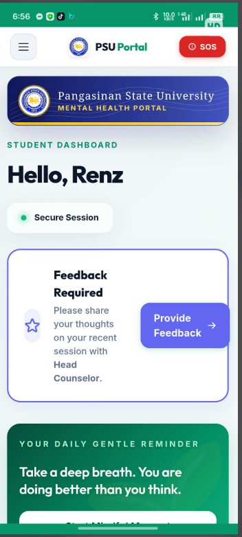
*Figure 29: Mobile Responsive Interface and One-Tap Floating Emergency SOS*

---

## Section B: One-Tap Floating Emergency SOS on Mobile

This section details how mobile users trigger instantaneous crisis intervention from any screen on their phone.

- **Step 1: On any screen in the mobile view, locate the prominent floating red "Emergency Help" button.**
- **Step 2: Tap the button to immediately display one-touch dialing for campus security, university clinics, and national crisis hotlines.**
- **Step 3: Tap "Call Counselor" to launch an instant mobile WebRTC video or audio crisis session directly from your smartphone.**

> **Note:** The mobile SOS button is permanently anchored to ensure students can request emergency intervention within seconds.

*Figure 30: Floating Emergency SOS Button on Mobile View*

---

## Section C: On-the-Go Wellness Tracking and Mobile AI Chat

This section explains how students complete daily mood logs and converse with Aria AI on mobile devices.

- **Step 1: Tap "Mood Journal" from the mobile menu to log your feelings using quick-touch mood emojis in under 30 seconds.**
- **Step 2: Tap "Talk to Assistant" to chat with Aria AI via an interface optimized for mobile keyboards and voice dictation.**
- **Step 3: Review your upcoming counseling appointments and check-in reminders directly on your mobile device.**

> **Note:** Mobile access ensures continuous emotional support is available to students wherever they are, on or off campus.

*Figure 31: On-the-Go Conversational Support with Aria AI*

---

